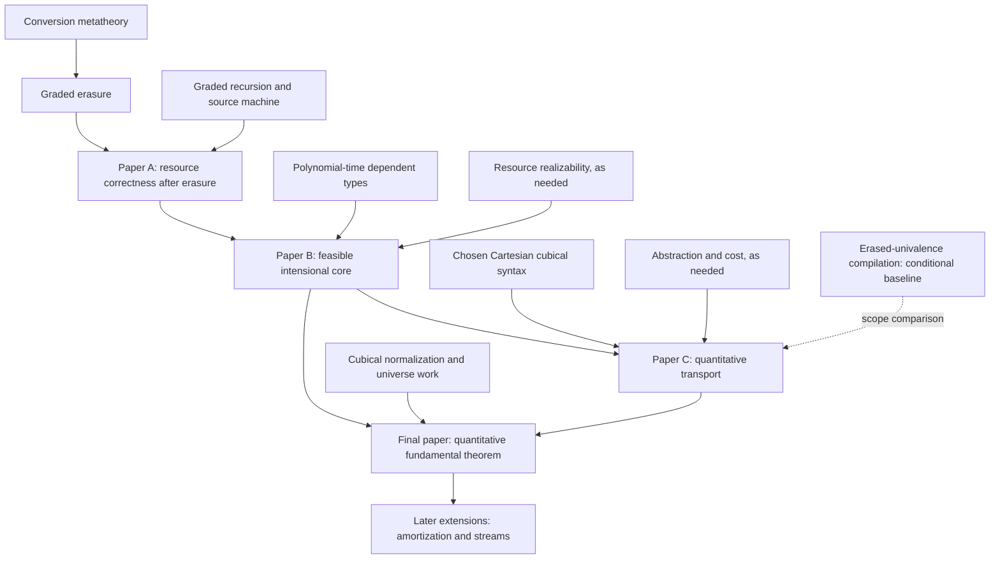

# Formalization roadmap and intermediate papers

Research plan, 30 October 2026. See the [research proposal](research-proposal.md) for the intended final theorem and [proof ideas](proof-ideas.md) for candidate arguments.

The recommended route is to develop the mathematics and its formalization together. Established papers supply audited components. Smaller new papers address the compatibility gaps. The final paper closes the combined theorem for one explicit calculus.

This document is a candidate mission catalogue, not a set of launched missions or frozen Lean declarations. The [30 October Prove2Me intake](prove2me-intake-2026-10-30.md) records the initial live search: no matching entries were found for the selected Abel sources; related existing missions have different scopes. Complete source review and exact statement audits remain part of mission preparation.

## What to start with

Start with the conversion-and-erasure line: Abel–Öhman–Vezzosi's conversion result, the graded-erasure extension, and the 2026 recursion/resource result. Their existing Agda developments provide unusually concrete guides to definitions and proof dependencies. Develop the polynomial-time line from Atkey's work alongside it. Delay the cubical integration until an executable graded core is working.

The first new research target should be **resource correctness after extraction**. It has a bounded operational question and a direct connection to an open problem identified by the authors of the graded theory. The larger programme should not depend on settling all of cubical normalization before producing a useful result.

The current workstream takes the Abel sources M1–M3; a separate effort handles Schwichtenberg papers. Prepare M1 first using the [source and mission plan](abel-mission-plan.md). Read the newly identified M11 draft now for prior work, then consider its formalization before Paper C. Hofmann–Moser's existing resource-analysis mission is already marked proved and belongs in the reuse review.

## Established papers to formalize first

Each row is a candidate **ResearchPaper** mission. One paper gets one mission; its other substantial results become milestones within that mission. The descriptions below identify mathematical targets, not final theorem signatures or source theorem numbers. Those must be fixed from the complete selected source version.

| ID / order | Source | Mission target and useful milestones | What it enables |
|---|---|---|---|
| M1 — first | Abel, Öhman, Vezzosi, **Decidability of Conversion for Type Theory in Type Theory**, POPL 2018. [Paper](https://doi.org/10.1145/3158111), [Agda development](https://mr-ohman.github.io/logrel-mltt/decofconv/). | Conversion decision for the paper's dependent calculus. Milestones: substitution/context conversion, logical relation, fundamental lemma, canonicity, algorithmic soundness and completeness. Preserve its actual type formers and universe scope. | A concrete normalization/checking foundation and binding infrastructure. |
| M2 — first | Abel, Danielsson, Eriksson, **A Graded Modal Dependent Type Theory with Erasure, Formalized**, [2026 extended version](https://arxiv.org/abs/2603.29716v2). | Soundness of erasure, with normalization and conversion results as companion milestones. Preserve the paper's modality conditions and restrictions on erased elimination. | A checked distinction between executable data and erasable information. |
| M3 — next | Eriksson, Abel, Danielsson, **On Recursion in Graded Modal Type Theory**, ICFP 2026. [Paper DOI](https://doi.org/10.1145/3828677), [archived Agda artifact](https://doi.org/10.5281/zenodo.21166412). | The source abstract machine's resource-correctness theorem, including the recursion rule and the selected quantitative modalities. Other modality results remain milestones of the same paper. | The baseline theorem that Paper A will extend to extracted execution. |
| M4 — second workstream | Atkey, **Polynomial Time and Dependent Types**, POPL 2024. [Source and artifact](https://bentnib.org/polytime-deptypes.html). | Polynomial-time soundness for QTT/LFPL; include the cons-free system and the paper's other major results as milestones. Preserve the original input encoding and equality discipline. | Feasible recursion, resource realizability, and the path toward FP expressiveness. |

M1–M3 share a development lineage, but this does not make their declarations interchangeable. Reuse compatible definitions and prove translations where presentations differ. The [current graded-theory repository](https://github.com/graded-type-theory/graded-type-theory) contains additions beyond individual papers; pin an artifact or commit matching each source.

The graded-recursion theorem concerns resource access on its source machine. It does not already establish a runtime theorem for erased target code. The authors' [issue on a lower-level correctness theorem](https://github.com/graded-type-theory/graded-type-theory/issues/95) identifies extraction and a different evaluation strategy as further work.

## Supporting missions, opened when a real dependency needs them

These are not all mandatory prerequisites. A source should become a mission when its theorem closes an identified obligation or supplies a reusable component worth the cost of formalizing it.

| ID | Source | Selected purpose and priority |
|---|---|---|
| M5 | Dal Lago and Hofmann, **Realizability Models and Implicit Complexity**, TCS 2011. [Paper](https://doi.org/10.1016/j.tcs.2010.12.025). | Resource monoids, bounded realizers, and complexity soundness. High priority if the M4 port needs this semantic layer as a shared library. |
| M6 | Niu, Sterling, Grodin, Harper, **A Cost-Aware Logical Framework**, POPL 2022. [Paper](https://arxiv.org/abs/2107.04663). | Cost/behavior separation and the model supporting cost verification. Useful for the semantic interface; an abstract cost annotation still needs an adequacy theorem for the chosen runtime. |
| M7 | Grodin, Li, Harper, **Abstraction Functions as Types**, POPL 2026. [Paper](https://arxiv.org/abs/2502.20496). | Modularity and abstraction with cost. Use its specification interface for the representation-change example. Record all ambient theory assumptions. |
| M8 | Angiuli, Brunerie, Coquand, Harper, Hou (Favonia), Licata, **Syntax and Models of Cartesian Cubical Type Theory**, MSCS 2021. [Paper](https://doi.org/10.1017/S0960129521000347). | A concrete Cartesian cubical syntax and semantic foundation. Review the exact presentation against M9 before choosing shared definitions. |
| M9 | Sterling and Angiuli, **Normalization for Cubical Type Theory**, LICS 2021. [Paper](https://arxiv.org/abs/2101.11479). | The published normalization and judgmental-equality results, at exactly their stated scope. Main high-risk dependency for the final normalization argument. |
| M10 | Bezem, Coquand, Dybjer, Escardó, **On Generalized Algebraic Theories and Categories with Families**, MSCS 2021. [Paper](https://arxiv.org/abs/2012.08370). | Initial syntactic models and structured interpretations. Formalize if it simplifies the common model interface; a general categorical framework need not precede every concrete proof. |
| M11 | Abel, Danielsson, Vezzosi, **Compiling Programs with Erased Univalence**, [2021 draft and extended version](https://www.cse.chalmers.se/~nad/publications/abel-danielsson-vezzosi-erased-univalence.html). | Direct prior work for compilation with erased cubical features. Its fundamental theorem and compilation corollary assume Conjecture 4.1. Preserve that conditional scope, and separately track the unproved metatheory before claiming an unconditional result. |

For universes, examine the extension in Chapter 7 of Sterling's [*First Steps in Synthetic Tait Computability*](https://www.cs.cmu.edu/~rwh/students/sterling.pdf), with the relevant later corrections. [*Controlling unfolding in type theory*](https://doi.org/10.1017/S0960129525100327) reports correcting an oversight in an earlier universe treatment. Pin the corrected argument before making a universe-level claim. A dissertation chapter can be a separately scoped mission, with its exact target stated explicitly.

The De Morgan cubical theory of [Cohen–Coquand–Huber–Mörtberg](https://arxiv.org/abs/1611.02108) is important background and an alternative source route. It is not the same calculus as the Cartesian presentation. A theorem about one does not discharge a theorem about the other without a proved comparison.

## Further papers for particular extensions

| Source | When it becomes useful |
|---|---|
| Aehlig, Berger, Hofmann, Schwichtenberg, **An Arithmetic for Non-Size-Increasing Polynomial-Time Computation**, TCS 2004. [Paper](https://doi.org/10.1016/j.tcs.2003.10.023). | A source-grounded mission connecting logical proofs to feasible extracted realizers. Its non-size-increasing restriction must remain visible; it is not by itself the whole FP characterization. |
| Bellantoni and Cook, **A New Recursion-Theoretic Characterization of the Polytime Functions**, 1992. [Author copy](https://www.cs.toronto.edu/~sacook/homepage/ptime.pdf). | An alternative completeness route if the chosen feasible calculus has a natural embedding of safe recursion. Do not develop this and a separate machine-simulation route merely for duplication. |
| Hofmann and Jost, **Static Prediction of Heap Space Usage for First-Order Functional Programs**, POPL 2003. [Author copy](https://www2.tcs.ifi.lmu.de/~jost/research/POPL_2003_Jost_Hofmann.pdf). | A controlled first heap-space/amortization extension. Heap allocation is a distinct metric from elapsed machine steps. |
| Grodin, Chu, Li, Hoffmann, Harper, **Potential Functions as Types**, [2026 preprint](https://arxiv.org/abs/2607.08547v2). | Prior art and a possible semantic dependency for automated credits and amortized analysis. Do not present the combination of potentials and dependent types as new. |
| Schwichtenberg and Wiesnet, **Logic for Exact Real Arithmetic**, LMCS 2021. [Paper](https://lmcs.episciences.org/7383). | A later application involving productive streams and division. It requires explicit precision and input-access models beyond the first-order finite-data core. |

Full induction-recursion, general higher inductive types, and general coinduction are postponed extensions. Their foundations should be formalized only after a concrete use determines the required scope.

## Paper A: Resource Correctness Survives Erasure

**Question.** Do the source language's graded resource guarantees survive extraction to a language with an explicitly chosen runtime strategy?

**Initial scope.** Use the required fragment of M2/M3, with natural-number recursion, dependent functions, and only the dependent pairs needed by the examples. Choose one target strategy, preferably a call-by-value closure machine for the first attempt. Validate that choice against source erasure before committing to it; call-by-need is a separate design.

**Proposed theorem.** For a well-typed graded source term and a related runtime environment, extracted evaluation returns a related value and respects the source resource specification. Erased bindings cannot be accessed. For affine resources, accesses and resources retained in the result stay within the supplied budget. For linear resources, state the appropriate conservation property, accounting for resources stored in returned closures or data.

The theorem must quantify over the actual compiler and machine defined by the paper. It must not assume that compiler correctness or resource preservation already holds.

**Proof route.** Relate source environments to target closures, establish erasure/substitution compatibility, then prove simulation and resource accounting through the recursion case. See [the detailed proof obligations](proof-ideas.md).

**Formal milestones.** Source and target definitions; environment relation; substitution; preservation; evaluation simulation; erasure non-access; the full resource theorem; executable examples.

**Standalone contribution.** A verified operational bridge beyond the source-machine result. A source-to-Lean port alone is a formalization contribution, not a newly discovered resource theorem. The authors' open issue motivates the target but is not a substitute for a wider novelty search.

**Completion condition.** A closed proof for the selected language, examples involving recursion and returned resource-bearing values, and an audit of the exact modality assumptions. Resource access counts do not yet constitute a polynomial-time bound.

## Paper B: Feasible Dependent Types without Equality Reflection

**Question.** Can a specified intensional dependent calculus retain the feasible computational expressiveness needed by the programme while supporting decidable conversion and the compiler from Paper A?

The starting compatibility problem is concrete: [Atkey's §3.1.4](https://arxiv.org/html/2307.09145v2#S3.SS1.SSS4) uses equality reflection in the erased fragment. Importing its complexity theorem does not import a conversion decision procedure for a different equality discipline.

**Proposed theorem.** For one explicitly defined intensional graded calculus with controlled recursion, prove normalization/decidable conversion, correct extraction to the selected machine, polynomial-time soundness, and first-order completeness for FP with an explicit representation theorem for binary words.

**Proof route.** Give a sound interpretation into a suitable resource-realizability model, together with normalization for the new syntax. Where helpful, interpret the intensional calculus into the existing extensional semantics. Completeness can use an embedded feasible programming fragment; it need not translate every extensional proof back into intensional syntax.

**Formal milestones.** Exact recursion and identity rules; resource substitution; semantic interpretation; machine adequacy; computable bound certificates; normalization; checking; a completeness translation and its cost/encoding lemmas.

**Standalone contribution.** The integration must be established for the new calculus and actual erasure compiler. If an existing theorem already supplies this package, revise the publication claim and reuse that result. Simply adding a time counter or restating Atkey's theorem is insufficient novelty.

**Completion condition.** A checked witness program, correctness theorem, and explicit polynomial all refer to the same extraction function. No unrestricted runtime recursor or uncharged oracle is hidden in the definitions. This paper supplies the feasible core before cubical features are introduced.

## Paper C: The Cost of Transport

**Question.** Which cubical equality and transport operations preserve a resource discipline?

**Initial scope.** Fix a compatible cubical fragment and the finite data needed for a representation-change example. Include a genuine computational transport/univalence case. A purely erased copy of ordinary mathematics with no interaction with executable code does not test the intended bridge.

**Prior-work checkpoint.** Compare the proposed rules with M11's CTT0ω and its restriction of Glue and higher constructors to erased code. Its conditional compilation theorem does not supply quantitative runtime bounds. Determine whether to discharge its conjectured metatheory, prove a comparison with our selected calculus, or follow another audited foundation before claiming the combined result.

**Proposed results.** Establish the boundary between arbitrary mathematical equivalences and certified feasible runtime conversions. Prove that the selected transport, substitution, and composition rules preserve operational resource evidence. If an equivalence's forward operation has a bound, executing the corresponding transport must have a bound justified by a simulation, including administrative overhead and any needed output-size information.

**Proof route.** Extend the resource relation along the cubical operations. The interesting obligations are stability under dimension substitution, dependent substitution, composition, and the univalence-related constructors. Ordinary function-composition bounds are preliminary lemmas, not the main result.

**Formal milestones.** A precisely stated obstruction example; typed equivalence packages and their computational bounds; substitution stability; composition; transport simulation; an abstract data-interface example.

**Standalone contribution.** A resource theorem for a specified interacting cubical fragment. Existing work on cost-aware abstraction is a starting point, not a novelty claim for this paper. Full normalization of the final combined language remains a distinct obligation.

**Completion condition.** The rules prevent arbitrary expensive equivalences from becoming uncharged feasible computations, while admitting a useful nontrivial transport example. A counterexample to the proposed rules is a valuable outcome and must lead to an explicit revised calculus.

## Final paper: Feasible Univalence

The final research contribution is a quantitative logical-relations/gluing theorem for the common calculus produced by Papers A–C. Its consequences are normalization, decidable conversion, canonical data results, correct extraction with bounds, and the retained FP characterization.

Normalization is not preserved merely because the separate starting calculi normalize. The interaction of grades, cubical operations, erasure, and universes must be handled in the combined proof. This is the central remaining discovery.

Earlier papers remain cited dependencies. The final paper should make clear which theorems are new integration results and which are reused. It should not repackage three completed papers as a new theorem without closing a further obligation.

## Dependency plan

The arrows below express intended research dependencies. They are not a formally verified source dependency graph.

M1–M4 are the initial source commitments. The semantic and cubical work can be investigated in parallel once their interfaces are specified; parallel research does not imply that incompatible encodings can later be joined automatically.

## How to formalize these results in Lean 4

Lean is the **metatheory** in this project. The object languages are represented as syntax with explicit judgments and operational semantics.

1. **Represent the actual languages.** Define contexts, terms, substitutions, grades, dimensions, typing, conversion, and execution. Keep paper-specific extensions explicit. A shared binding library is useful, but shared notation is not a proof that two calculi coincide.
2. **Keep object equality separate.** Object-language path types and judgmental equality must not simply be replaced by Lean's equality. Lean equality can compare syntax or express metatheorems about it; it does not supply the object's cubical univalence.
3. **Prove the interpretation.** A model can be used, but its relationship to the chosen syntax is a theorem. Do not axiomatize univalence for Lean's own `Type` or assume an all-purpose model with the desired properties.
4. **Implement the promised algorithms.** A normalization or extraction claim should provide the relevant functions and their correctness proofs. A noncomputable choice of a normal form does not provide the intended normalizer. Keep any classical metatheoretic reasoning separate from the computational claims it does not justify.
5. **Make cost concrete.** Pin the evaluation strategy, sharing, primitive operations, word encoding, and cost metric. Prove the relation to the chosen machine model. Count resource accesses, time, and space with distinct definitions.
6. **Keep witnesses shared.** Correctness and complexity must concern the same extracted program and input representation. Quantifier order must preserve the fact that a bound is uniform over all inputs for a fixed program.

Inductive-recursive Agda definitions may require a different metatheoretic construction in Lean. Prove that construction faithfully represents the source; do not hide the missing construction inside a typeclass assumption.

## How the Prove2Me programme would run

The platform supports source-based mission proposals, reusable definitions and theorem imports, and verified reductions to open children. The following workflow follows the [official captain guide](https://prove2.me/tour/mission-captain) and [agent verification documentation](https://github.com/prove2me/prove2me_workspace/blob/main/references/prove.md).

1. **Inventory before creating.** Search live missions, definitions, theorems, and relevant upstream Lean libraries. Compare exact statements, environments, and dependencies. Reuse faithful matches.
2. **Pin the source and environment.** Record the paper version, relevant sections and errata, artifact commit, and the selected platform Lean/Mathlib environment. All mutually importing platform items must live in a compatible environment.
3. **Specify definitions before goals.** Create source-faithful definition bodies and compile exact intended theorem statements. A topic list or this roadmap is not a frozen formal interface.
4. **Audit independently.** Compare the full definitions and binders against the source. An independent reader should explain what the Lean code actually says without being told its intended meaning. Resolve discrepancies before launch.
5. **Prepare a reviewable proposal.** One research paper becomes one mission with a central goal and supporting milestones. New unproved research belongs in an explicitly identified open-problem proposal; it must not be advertised as an established paper theorem.
6. **Use the platform's human launch step.** The agent can prepare the private proposal, but the human captain reviews the statements and submits it. This is a platform requirement, not a new approval policy for ordinary local proof work. Public proposals also undergo moderator review.
7. **Prove with small verified dependencies.** Publish approved definitions first. A solution uses a top-level `theorem solution` with the exact target type and no local `sorry`. It may import other platform theorems, but never its own target.
8. **Distinguish reduction from closure.** `SKETCH_ACCEPTED` records a checked reduction with open dependencies. It is not a completed proof. Check the live root status and the status of its entire dependency closure before claiming completion.
9. **Rebuild the final artifact.** Mirror the actual completed proofs into a pinned local development, check exact statements and axioms, and compare the formal result with the source. Local reference files containing platform placeholders are not evidence of an axiom-free closed proof.

Mission descriptions should introduce the objects, state the exact targets and conventions, explain significance and difficulty, and cite the source. Proof strategy belongs in separate notes and reduction explanations. These repository documents are research plans, not substitutes for those mission descriptions.

## Stage gates and the first work package

| Gate | Evidence required before proceeding |
|---|---|
| G0: source and reuse | Full source sections read; known artifacts inspected; matching platform/library results checked; novelty comparison recorded. |
| G1: definitions | A small source-faithful syntax/semantics slice elaborates, with exact statements reviewed. |
| G2: operational pilot | Substitution, erasure, and one recursive example are proved for a clearly identified pilot fragment. |
| G3: Paper A | The complete promised operational resource theorem closes. |
| G4: Paper B | The intensional feasible core has its checking, extraction, complexity, and representation results. |
| G5: Paper C | A nontrivial cubical transport example passes the complete quantitative preservation argument. |
| G6: final paper | Combined normalization and quantitative extraction close with audited dependencies and a reproducible artifact. |

The first work package is to select the exact M1–M3 source versions, inspect their Agda definitions, and prepare a small source-faithful operational pilot for Paper A. In parallel, record precisely which M4 rules can be interpreted in the proposed intensional core and which require replacement. The first public mission proposal should follow that source and definition audit.

Do not assign a fixed completion date to the final discovery before these gates. Each intermediate paper should remain useful if the full conjecture fails or must be revised.
