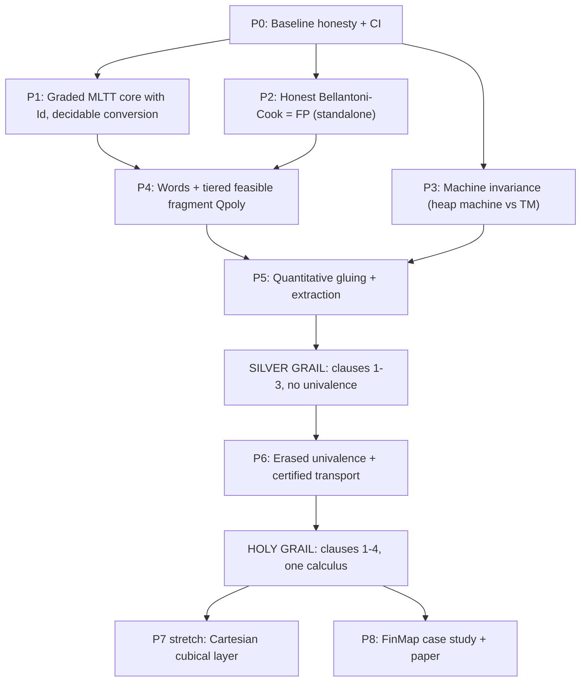

# Holy Grail Plan: One Calculus, One Theorem

Draft, 7 November 2026. Companion to the [research proposal](research-proposal.md) and the [formalization roadmap](formalization-roadmap.md).

This document plans the formal proof of the central theorem of the research proposal **for a single calculus**, in Lean 4, with no assumed conclusions. It also records what the current repository does and does not already establish, so that the work starts from an honest baseline.

---

## 1. The target

### 1.1 Statement

Construct one predicative, graded dependent type theory $\mathcal Q$ (concrete de Bruijn syntax `Q.Term`, one typing judgment, one reduction relation), a syntactically defined feasible fragment $\mathcal Q_{\mathrm{poly}}$, one fixed machine $M$, and prove **for that same calculus**:

1. **Normalization and checking.** Weak-head normalization; decidable type and term conversion; decidable checking of fully annotated terms; canonicity for closed `ℕ` and closed `W` (binary words).
2. **Correct quantitative extraction.** A Lean function `extract` maps every derivation of `⊢ t : Π (x : W). Σ (y : W). R x y` in $\mathcal Q_{\mathrm{poly}}$ to a program `e_D` and a Lean function `bound` maps it to a polynomial `P_D`, both computed **from the derivation**, such that for every input `x`: running `e_D` on `x` in `M` terminates with `y`, `R x y` holds, and `steps_M(e_D, x) ≤ P_D(|x|)`.
3. **Exact first-order expressive power.** $\operatorname{DefFun}(\mathcal Q_{\mathrm{poly}}, W \to W) = \mathrm{FP}$, where FP is defined independently of $\mathcal Q$ (polynomial-time Turing machines, or a machine model proved polynomially equivalent to them).
4. **Controlled univalence.** Univalent reasoning is available in the specification (erased) layer. Every runtime transport/coercion carries a polynomial certificate. As a corollary of (2) and (3), a runtime-usable equivalence $e_h(x,b) = (x, b \oplus h(x))$ exists in $\mathcal Q_{\mathrm{poly}}$ only if $h \in \mathrm{FP}$.

### 1.2 Lean shape (schematic)

```lean
namespace Q
-- (1)
def decTypeEq : TypeWf Γ A → TypeWf Γ B → Decidable (TypeEq Γ A B)
def decTermEq : HasType Γ t A → HasType Γ u A → Decidable (TermEq Γ t u A)
def check     : (Γ : Ctx) → (t A : Term) → Decidable (HasType Γ t A)   -- annotated terms
theorem canonicity_W : HasType [] t .W → ∃ w : Word, TermEq [] t (encode w) .W

-- (2)
def extract : Poly.Deriv [] t (.pi .W (.sigma .W R)) → Machine.Prog
def bound   : Poly.Deriv [] t (.pi .W (.sigma .W R)) → Polynomial
theorem extraction (D : Poly.Deriv [] t (.pi .W (.sigma .W R))) (x : Word) :
  ∃ y n, Machine.Run (extract D) x y n ∧ Realizes R x y ∧ n ≤ (bound D).eval x.length

-- (3)
theorem defFun_eq_FP : {f : Word → Word | Poly.Defines f} = FP   -- FP via Turing machines
end Q
```

### 1.3 Non-cheating rules (acceptance criteria)

Every gate below is checked against these rules by an independent blind auditor:

| # | Rule |
|---|---|
| R1 | **One syntax.** All four clauses quantify over the same `Q.Term`, `Q.HasType`, and `Q.Step`. No conjunction of results about different calculi. |
| R2 | **No oracle primitives.** No constructor of the calculus or of the feasible fragment may take an arbitrary Lean function (`Word → Word`, `Nat → Nat`, …) as data. Primitives are a fixed finite list with fixed costs. |
| R3 | **Certificates from syntax.** `bound` is defined by structural recursion on derivations (or erased terms); it never evaluates the program. |
| R4 | **Real derivations.** Extraction consumes typing derivations, not records that already contain the program and its correctness proof. Specification proofs are terms of the calculus, not `Nat` tags. |
| R5 | **Independent FP.** FP is defined outside $\mathcal Q$ by a standard machine model; every relationship between `M` and that model is proved. |
| R6 | **Constructive core.** No `sorryAx`, no custom axioms, no `Classical.choice` in the main theorem's closure (checked by CI with `#print axioms`). |

The research proposal already demands R2–R4: *"A feasible fragment consisting merely of programs bundled with an assumed polynomial-time proof would not establish the intended syntactic characterization."*

---

## 2. Honest baseline

| Component | Location | Reusable? | Notes |
|---|---|---|---|
| M1 logical relation, decidable conversion | `Abel2018/` (12,979 lines) | **Yes, as technique and template** | Calculus is Π, ℕ, U only, no grades. |
| M2 graded usage, erasure, erasure soundness | `FeasibleUnivalence/{Modality,Usage,Erasure}.lean` | **Yes** | `GTerm` already has Σ, Unit, grades. No typing judgment of its own and no conversion decision for `GTerm`. |
| M3 graded heap machine, resource correctness | `FeasibleUnivalence/HeapMachine.lean` | **Yes** — candidate for machine `M` | Needs a proved cost relationship to a standard model (R5). |
| Paper A erased-machine simulation | `FeasibleUnivalence/PaperA.lean` | **Likely yes** | Needs an independent audit before reuse. |
| M4.0 Atkey costed machine | `formalization/atkey2024/` | Partially | Useful reference for LFPL-style cost. |
| Paper B `FeasibleProg` / `BCSafeDerivation` | `FeasibleUnivalence/PaperB.lean` | **No — rebuild** | `boundedTransition` takes an arbitrary `stepFn : Word → Word` (violates R2), so FP-completeness is vacuous and soundness says nothing about real complexity. |
| Paper C cubical layer, `QuantEquiv` | `FeasibleUnivalence/PaperC.lean` | **Interface only** | Evaluates over `FeasibleProg`; inherits the Paper B oracle. `transport_obstruction_xor` is not meaningful under R2. |
| Synthesis `QuantGlued`, `PiSigmaDerivation` | `FeasibleUnivalence/Synthesis.lean` | **Interface only** | `PiSigmaDerivation` takes program + correctness as fields (violates R4); main theorem is a conjunction across four calculi (violates R1). |

**Action before Phase 1:** relabel Papers B, C and Synthesis as *interface models* in `README.md`, `HANDOVER.md`, and `source-review.md`.

---

## 3. Design decisions (to confirm)

| Decision | Recommended | Alternatives | Why |
|---|---|---|---|
| D1 Base calculus | **Graded MLTT of the M2 source** (Abel–Danielsson–Eriksson, ICFP 2023 / JFP): Π, Σ, ℕ, Unit, Empty, Id, U, grades | Extend M1's ungraded `Term` | The M2 Agda artifact already proves decidable conversion and type checking for the graded theory; porting it merges M1 and M2 into one calculus and reuses `GTerm`. |
| D2 Binary words | **Built-in inductive `W`** with `ε`, `s0`, `s1`, `wrec` | `List Bool` encoding | Needed for clause (2)/(3) bit-length bounds; built-in keeps canonicity and cost of `wrec` explicit. |
| D3 Feasibility discipline | **Safe/normal tiering as a modality** (Bellantoni–Cook) on `wrec` | Hofmann LFPL / Atkey QTT diamonds | Tiering fits the existing `Modality` interface and avoids the equality-reflection conflict in Atkey's system recorded in the [M4 rule audit](atkey-rule-audit.md). Revisit if tiering is too weak for the case study. |
| D4 Machine `M` | **M3 graded heap machine** + proved polynomial invariance to a Turing machine / weak CBV λ-calculus | Weak CBV λ-calculus directly (Forster–Kunze–Roth) | Reuses M3 + Paper A; invariance is a well-understood, bounded proof obligation. |
| D5 Univalence | **Erased univalence first** (univalence/`ua` only at grade 0), certified runtime coercions second | Cartesian cubical (M8/M9) | Erased univalence keeps normalization tractable inside the M1/M2 logical-relation technique. Cubical is a separate stretch goal (Phase 7). |

---

## 4. Phases and gates



### P0 — Baseline honesty and infrastructure (small)

- Relabel interface models (Section 2).
- GitHub Actions: `lake build` for both Lake projects; an axiom-audit file that `#print axioms` every headline theorem and fails on `sorryAx` / `Classical.choice` / custom axioms.
- Fuel-free deciders for M1 (`decTypeEq`, `decTermEq` via `Nat.find` on `theorem_4_12_computational`) — closes item 5 of the external M1 review.
- **Exit:** CI green; README states exactly which theorems are paper ports and which are models.

### P1 — Graded MLTT core with identity types (large; ~15–25k lines)

Port the logical relation and decidability-of-conversion development of the M2 Agda artifact to Lean, on top of `GTerm`, extended with `Empty` and `Id`.

- Typing/equality judgments for `GTerm` (usage-independent, as in the source).
- Logical relation via the `LogRelAt` / `RedRel` encoding proved coherent in M1 (irrelevance + escape).
- Fundamental theorem, consequences (canonicity, injectivity, consistency), algorithmic conversion, Theorems 4.11/4.12 analogues, bidirectional type checking.
- Connect to M2/M3: `Usage` and erasure soundness now hold for **typed** `GTerm` derivations.
- **Exit (Gate HG1):** clause (1) for graded MLTT with Id; M1 recovered as the ungraded fragment (optional sanity theorem).
- **Prove2Me:** stage as a direct-port mission of the M2 source paper.

### P2 — Honest Bellantoni–Cook characterization of FP (medium; ~5–8k lines, parallel with P1)

Rewrite Paper B with R2 enforced. Standalone, publishable as a formalization.

- Fixed primitives: `0`, projections, `s0`, `s1`, `p` (predecessor), `cond`; safe composition; safe recursion on notation.
- FP defined by single-tape (or multi-tape) Turing machines over `{0,1}`.
- Soundness: every BC function runs in polynomial time on the TM model (via a compositional size/time polynomial, R3).
- Completeness: simulate any polytime TM in BC (Bellantoni–Cook 1992).
- Prior art to compare against: Heraud–Nowak, *A Formalization of Polytime Functions* (ITP 2011, Coq).
- **Exit (Gate HG2):** `BC.defFun_eq_FP` with no oracle primitives; blind audit of R2/R5.

### P3 — Machine invariance (medium; ~4–8k lines, parallel)

Prove the M3 heap machine (with the erased-target variant of Paper A) is a *reasonable* cost model: its step count is polynomially related to TM time, with explicit word/heap-size accounting.

- References: Accattoli–Dal Lago, *Beta reduction is invariant, indeed* (CSL-LICS 2014 / LMCS 2016); Forster–Kunze–Roth, *The weak call-by-value λ-calculus is reasonable for both time and space* (POPL 2020, mechanized in Coq).
- **Exit (Gate HG3):** `Machine.steps` ≤ poly(TM time) and TM time ≤ poly(`Machine.steps`, input size), both directions proved.

### P4 — Words and the tiered feasible fragment $\mathcal Q_{\mathrm{poly}}$ (large)

- Add `W` with `wrec` to the P1 calculus; extend the logical relation, conversion checker and canonicity (`canonicity_W`).
- Define $\mathcal Q_{\mathrm{poly}}$ by a tier modality: recursion arguments of `wrec` at *normal* tier, results usable only at *safe* tier; higher-order use restricted as needed (first-order FP target).
- Embed P2: every BC program translates to a $\mathcal Q_{\mathrm{poly}}$ derivation with the same extensional behavior → completeness half of clause (3).
- **Exit (Gate HG4):** $\mathcal Q_{\mathrm{poly}}$ is a syntactic subsystem of the P1 calculus; normalization/decidability still hold; BC embeds.

### P5 — Quantitative gluing and extraction (very large; the central discovery)

One logical relation over $\mathcal Q_{\mathrm{poly}}$ with three components per type:

1. reducibility (for normalization, reusing P1),
2. erased realizer on machine `M` (reusing M2/M3/Paper A),
3. a cost potential / polynomial certificate computed from the derivation (R3).

- Fundamental lemma covering dependent substitution, `wrec`, erased elimination, `Id`/`J`, universes.
- `extract`, `bound`, and `extraction` (clause 2); combined with P3, the soundness half of clause (3).
- Separation theorem: normalization during checking is unrelated to runtime cost (a genuine counterpart of `normalization_vs_runtime_cost_separation`, quantified over real derivations).
- **Exit (Gate HG5 = SILVER GRAIL):** clauses (1)–(3) for one calculus. This is already a strong paper: *Feasible Dependent Types without Equality Reflection*.

### P6 — Erased univalence and certified transport (large; research risk)

- Add univalence at grade 0 only (e.g. `ua` and its computation rule as erased constants, or an erased `Glue`/`V` former). Prove: normalization and decidable conversion survive; canonicity for relevant `ℕ`/`W` survives because `ua` cannot reach relevant positions (usage rules).
- Certified runtime coercion: an equivalence whose forward/backward maps are $\mathcal Q_{\mathrm{poly}}$ derivations yields a runtime coercion with a composed polynomial certificate.
- Obstruction corollary: if $e_h$ is runtime-usable then $h \in \mathrm{FP}$ (now meaningful because R2 holds).
- Survey first: Danielsson's work on erasure and univalence in Agda (`@0`, `--erased-cubical`), and M7 (Grodin–Li–Harper, *Abstraction Functions as Types*).
- **Exit (Gate HG6 = HOLY GRAIL):** clauses (1)–(4) for one calculus.

### P7 — Stretch: Cartesian cubical layer

Replace erased univalence by a computational Cartesian cubical fragment (M8 syntax) with normalization following Sterling–Angiuli (M9, LICS 2021). To our knowledge no complete mechanization of cubical normalization exists; even a fragment would be a standalone contribution. Not on the critical path.

### P8 — Case study, artifact, paper

- Abstract finite-map interface with list and balanced-tree implementations, written **inside** $\mathcal Q$; correctness transferred along an (erased) equivalence/abstraction relation; distinct linear vs logarithmic certificates extracted by `bound`.
- Reproducible artifact, blind read-back audit of every headline statement, Prove2Me missions for each gate.

---

## 5. Risk register

| Risk | Likelihood | Impact | Mitigation |
|---|---|---|---|
| Tiering too weak for dependent types (BC tiers clash with large elimination / universes) | Medium | High | Restrict $\mathcal Q_{\mathrm{poly}}$ to first-order word functions with erased dependent specifications; fall back to LFPL-style grading (D3 alternative). |
| Cost component of the gluing relation does not compose under dependent substitution | High | Critical | Prototype P5 first on simply-typed + `W` (no Π dependency) before the full calculus; keep certificates on erased terms only. |
| P1 port size (M2 artifact is large) | High | Medium | Port incrementally by type former; reuse M1 modules and coherence lemmas; stage on Prove2Me to parallelize. |
| Erased univalence breaks canonicity or decidability | Medium | High | Prove usage-based non-interference first (cf. M3 `SecurityLevel.non_interference`); if it fails, keep univalence purely in Prop-like erased universe. |
| Machine invariance harder for heap machine than for weak CBV | Medium | Medium | Switch D4 to the Forster–Kunze–Roth weak CBV model and prove a simulation from the heap machine. |
| Overclaiming again | — | High | R1–R6 audit at every gate; README updated only after gate exit. |

---

## 6. Order of work

1. **P0** (immediately).
2. **P1, P2, P3 in parallel** — independent; P2 and P3 are de-risking and individually publishable.
3. **P5 prototype** on a simply-typed + `W` toy as soon as P2/P3 exist, before P1 finishes — this tests the riskiest idea earliest.
4. **P4 → P5** on the full calculus → Silver Grail.
5. **P6** → Holy Grail; P7/P8 afterwards.

## 7. Open questions for the team

1. Confirm D1–D5, especially D3 (BC tiering vs LFPL) and D5 (erased univalence before cubical).
2. Is the Silver Grail (no univalence) an acceptable first publication target?
3. Which phases go to Prove2Me as missions (direct ports: P1, P2 prior art, P3 references) versus stay in-repo as open research (P5, P6)?
